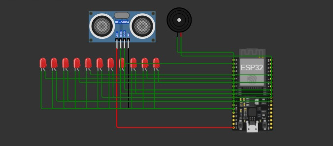

   
Tico Tech  

 

## :pushpin: Descrição

Este projeto consiste no desenvolvimento de um Simulador de Avisos Visuais e Sonoros de Metrô, projetado para replicar o sistema de navegação e informação aos passageiros encontrado nos trens modernos. Utilizando o microcontrolador ESP32 como cérebro do sistema, o projeto gerencia de forma dinâmica a progressão das estações e as sinalizações de emergência ou transição.

 

## :robot: Montagem do dispositivo físico

### Lista de materiais

| Quantidade | Nome | Link para referência |
| --- | --- | --- |
| 1 | ESP32 e cabo USB | https://www.baudaeletronica.com.br/placa-doit-esp32-bluetooth-e-wifi.html |
| 1 | Sensor de proximidade HC-SR04 | https://www.baudaeletronica.com.br/sensor-touch-capacitivo-ttp223b.html |
| 1 | Buzzer 5V | https://www.baudaeletronica.com.br/produto/buzzer-5v.html |
| 11 | Leds | https://www.baudaeletronica.com.br/produto/led-de-alto-brilho-branco |

### Lista de conexões

| Componente | Pino da placa |
| --- | --- |
| ECHO do HC-SR04 | 18 |
| Buzzer (+) | 19 |
| LED 1 | 13 |
| LED 2 | 14 |
| LED 3 | 16 |
| LED 4 | 17 |
| LED 5 | 21 |
| LED 6 | 22 |
| LED 7 | 23 |
| LED 8 | 25 |
| LED 9 | 26 |
| LED 10 | 27 |
| LED 11 | 32 |

### Funcionamento dos sensores e atuadores:

#### Sensor de proximidade HC-SR04

O HC-SR04 é um sensor de distância ultrassônico que realiza medições na faixa de 2cm até 400cm sem a necessidade de contato físico com o alvo. O sensor utiliza sinais sonoros de alta frequência (40 kHz) para calcular a distância com base no tempo de ida e volta da onda mecânica, além de possuir um ângulo de abertura menor que 15°, o que permite direcionar a medição para alvos específicos de forma simples e poupando pinos de interrupção complexos do projeto. (Especificação técnica: curtocircuito.com.br)
Este sensor possui precisão de mais ou menos 3mm em sua faixa de medição ideal. Suas principais características são:

- Chip: HC-SR04;
- Tensão de operação: 5VDC;
- Consumo: 15mA (corrente de trabalho);
- Comunicação: Pulso de Trigger / Retorno por Echo;
- Faixa de medição: 2cm a 400cm;
- Resolução de saída: Pulso de tempo proporcional à distância;
- Tempo de conversão: Pulso de trigger de 10µs (mínimo);
- Precisão: ±3mm dentro da faixa de alcance;

### Circuito

Figura - Diagrama do circuito 
   

 

 

## :electric_plug: Funcionamento do sistema

**Não esqueça: adicione um videozinho do sistema funcionando :)**

- O código utiliza um ESP32 para controlar um sensor ultrassônico, um buzzer e 11 LEDs. Inicialmente, são importadas as bibliotecas necessárias e configurados os pinos e parâmetros de funcionamento dos componentes. A biblioteca asyncio permite executar diferentes tarefas simultaneamente, sem que uma precise esperar a outra terminar.

- A função apagar_leds() percorre todos os LEDs e os desliga. Já a função medir_cm() realiza uma medição utilizando o sensor ultrassônico, calculando a distância a partir do tempo de retorno do sinal. A função distancia_filtrada() realiza várias medições e utiliza a mediana dos valores para reduzir possíveis oscilações e ruídos.

- Para controlar o buzzer, a função tocar_musica() reproduz uma melodia de acordo com as notas, suas durações e o BPM definido. A função sequencia_musicas() organiza a reprodução das músicas, alternando entre elas e estabelecendo intervalos antes de iniciar a próxima.

- O controle dos LEDs é realizado pelas funções piscar() e sequencia_leds(). A primeira faz um LED piscar durante um período determinado, enquanto a segunda organiza a sequência de acionamento dos 11 LEDs, definindo os tempos em que cada um permanece piscando ou aceso.

- Por fim, a função principal() coordena todo o sistema. Ela monitora continuamente a distância medida pelo sensor e, ao detectar a aproximação de um objeto, inicia simultaneamente as sequências de músicas e LEDs. Caso detecte o afastamento do objeto, interrompe as tarefas e recalibra a distância de referência.

- A execução começa com asyncio.run(principal()), que inicia o monitoramento e mantém o sistema funcionando continuamente.

 

## :busts_in_silhouette: Contribuir no projeto

### Features implementadas

- [x] Sensor de identificação de presença do condutor
- [x] Buzzers de reproduçao das musicas de parada da linha 4
- [x] Leds de identificação de estações

### Features para incrementar no projeto

- [ ] Avisos de ocorrências na via
